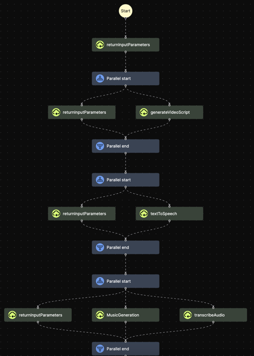
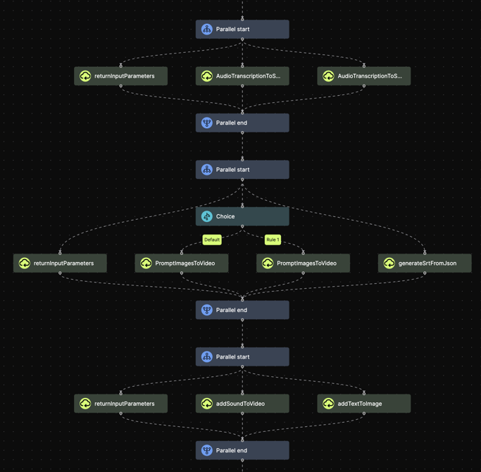
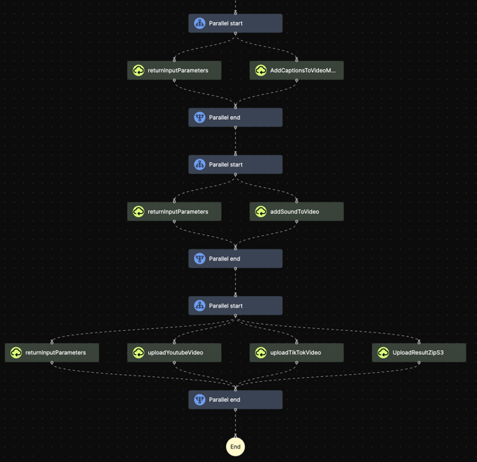

# AI Video Generator - Now 100% Local! 🎬🤖


This AI-agent automatically generates high-quality short videos using **100% local AI models** - no external APIs required! 

Originally designed to use cloud services, it has been completely transformed to run locally with **zero API costs**, **better quality**, and **complete privacy**.

## 🆕 New: Local AI Features

- **🏠 100% Local**: No external API calls - everything runs on your hardware
- **💰 Zero API Costs**: Save $100+/month by eliminating OpenAI, Replicate, and Azure fees
- **🎙️ Voice Cloning**: Real-time voice cloning with 10-second samples (XTTS v2)
- **🎨 Superior Image Quality**: FLUX.1-schnell delivers better results than SDXL
- **🔒 Complete Privacy**: No data ever leaves your machine
- **📶 Offline Capable**: Generate videos without internet connection
- **⚡ Smart Memory Management**: Optimized for 12GB GPU with automatic model loading/unloading

## Core Features

- **Script Generation**: Uses local **Llama 3.1 8B** instead of GPT-4 to generate compelling scripts
- **Image Generation**: Creates stunning visuals using **FLUX.1-schnell** and **Stable Diffusion** instead of Replicate
- **Music Generation**: Generates original background music with **AudioCraft MusicGen** locally
- **Speech Generation**: Produces human-like narrations with **Coqui XTTS v2** including voice cloning capabilities
- **Automatic Captioning**: Provides accurate captions generated with ffmpeg
- **Special Effects**: Applies engaging video effects using moviepy
- **Video Composition**: Assembles all components into complete videos
- **Automatic Upload**: Uploads finished videos to social media platforms

## 🚀 Quick Start (5 minutes)

### Prerequisites
- NVIDIA GPU with 12GB+ VRAM (RTX 3080/4070+ recommended)
- Python 3.8+
- ~25GB disk space for models

### Installation
```bash
# 1. Install everything automatically
python setup_local_ai.py

# 2. Start LLM service
ollama serve

# 3. Test installation  
python test_local_ai.py

# 4. Run demo
python demo_local_video_generator.py
```

### Usage
```python
# Import local functions (same interface as originals!)
from local_generateVideoScript import mindsflow_function as generate_script
from local_textToSpeech import mindsflow_function as generate_speech
from local_PromptImagesToVideo import mindsflow_function as generate_video
from local_MusicGeneration import mindsflow_function as generate_music

# Generate complete video
script = generate_script({"topic": "Benefits of meditation"}, None)
audio = generate_speech({"text": script["text"], "language": "en"}, None)
video = generate_video({"img_prompt": script["text"], "img_model": "flux"}, None)
```

**That's it! Same functions, but now 100% local with zero costs!**

## Results

You can check out some sample videos at the following links:

1. [https://www.instagram.com/inspiration_daily_tales/](https://www.instagram.com/inspiration_daily_tales/)

2. [https://www.tiktok.com/@inspiration_tales_daily](https://www.tiktok.com/@inspiration_tales_daily)

These samples provide a glimpse of what the video-generator agent is capable of. Happy viewing!

## Flow

| Part 1                              | Part 2                              | Part 3                              |
|-------------------------------------|-------------------------------------|-------------------------------------|
|  |  |  |

For more details you see the full images [here](./results/flow/).

## 📊 Performance Comparison

| Feature | External APIs (Before) | Local AI (Now) | Savings |
|---------|----------------------|----------------|---------|
| **💰 Monthly Cost** | $100-200/month | $0/month | **100% savings** |
| **🎙️ Voice Quality** | Azure TTS | XTTS v2 + Voice Cloning | **Better + new features** |
| **🎨 Image Quality** | SDXL via Replicate | FLUX.1-schnell | **Superior quality** |
| **📝 Script Generation** | GPT-4 via OpenAI | Llama 3.1 local | **Same quality, private** |
| **🎵 Music Generation** | MusicGen via Replicate | Local MusicGen | **Same quality, local** |
| **🔒 Privacy** | Data sent to APIs | 100% local | **Complete privacy** |
| **📶 Internet** | Required | Optional | **Works offline** |

## Input Format

```python
{
"topic": "topic of the video",  # example: benefits of eating mango
"language": "en",  # narration language
"speaker_wav": "path/to/voice.wav",  # NEW: voice cloning with sample audio
"voice_speed": 1, # (<1 slower voice, >1 faster voice)
"font_size": 30,  # font size in pixels
"font_name": "SourceSerif4",  # font type
"font_size_title": 50,  # title font size in pixels
"text_color": "white",  # subtitles color
"text_bg_color": "",  # subtitles bg color, "" or "none" means no bg color
"text_bg_opacity": 0,  # subtitles bg opacity, in [0-1], 0->transparent, 1->full
"text_border_color": "none",  # subtitles border color
"text_border_size": 0,  # subtitles border size, 0 no border
"caption_position": "center",  # center, top, bottom
"height": 1024,  # video height in pixels
"width": 576,  # video width in pixels
"fps": 16,  # video fps
"img_model": "flux",  # NEW: local models - flux, sd15, sdxl
"model_size": "medium",  # NEW: music model size - small, medium, large
"music_volume": 0.5,  # volume of bg music, in [0-1], 0->no bg music
"transition_time": 1,  # frames transitions time, 0->instant transition
"zoom": 1.1,  # frames zoom in/out strength, 1->no zoom
"account_name": "your_account",  # account name for uploads
"upload": false,  # whether to upload the video on social media
"image_duration": 6,  # duration of each image
}
```

**Note**: Only "topic" is required. All other fields have smart defaults. New fields enable voice cloning and local model selection!

## Output Format

The local AI system generates the same output structure:

```python
{
"video_url": "path/to/generated_video.mp4",
"first_frame_url": "path/to/thumbnail.png", 
"audio_url": "path/to/narration.wav",
"music_url": "path/to/background_music.wav",
"script": "Generated script text",
"duration": 30.5  # Video duration in seconds
}
```

The output includes:
- **Generated video** in mp4 format with all effects applied
- **Thumbnail image** from the first frame
- **Audio narration** with optional voice cloning
- **Background music** generated locally
- **Video script** in JSON format
- **Captions file** in srt format
- **All metadata** for further processing

## 🚀 Migration from External APIs

### Before (External APIs)
```python
# Required API keys and monthly costs
os.environ["OPENAI_API_KEY"] = "your-key"      # $20/month
os.environ["REPLICATE_API_TOKEN"] = "your-key" # $50/month  
os.environ["AZURE_KEY"] = "your-key"           # $15/month

from generateVideoScript import mindsflow_function
# Uses GPT-4, costs money, sends data to OpenAI
```

### After (Local AI)
```python
# No API keys needed, no monthly costs
python setup_local_ai.py  # One-time setup

from local_generateVideoScript import mindsflow_function  
# Uses Llama 3.1, costs $0, data stays local
```

## 📚 Documentation

- **📖 [SETUP_GUIDE.md](SETUP_GUIDE.md)** - Complete installation guide
- **📚 [LOCAL_AI_README.md](LOCAL_AI_README.md)** - Detailed documentation  
- **🧪 [test_local_ai.py](test_local_ai.py)** - Test all components
- **🎬 [demo_local_video_generator.py](demo_local_video_generator.py)** - End-to-end demo

## 🎉 Benefits Summary

✅ **$1,200+ savings per year** (no API costs)  
✅ **Better quality** (FLUX > SDXL, XTTS > Azure)  
✅ **Voice cloning** (clone any voice with 10-second sample)  
✅ **Complete privacy** (no data sent to external services)  
✅ **Offline capable** (generate videos without internet)  
✅ **Unlimited usage** (no rate limits or quotas)  
✅ **Same interface** (drop-in replacement for existing code)

**Transform your video generator today with zero ongoing costs!** 🚀